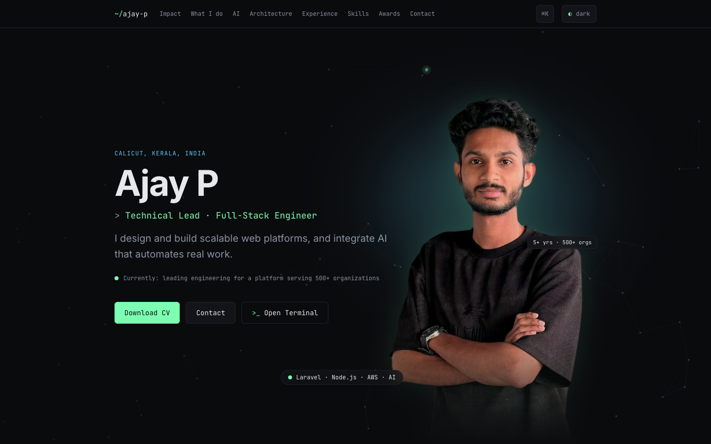

# Ajay P — Portfolio

The personal site of Ajay P, Technical Lead and Full-Stack Engineer: a single-page portfolio built to feel
like a developer tool, where every visual effect carries a real system or a real number.

**Live:** https://ajaypaju.github.io/



## Features

- **Prompt → Task walkthrough** — an animated, synced terminal and flow diagram showing how a plain-language
  prompt in Claude Code becomes a task in a production SaaS platform: role-based MCP server, platform API,
  and an AI bot user that completes it.
- **Request-flow architecture map** — the production path from the browser through Cloudflare to servers on
  AWS, with live request traffic, a "Trace a request" mode and a deploy-flow view. Every node explains what
  I built there.
- **Terminal mode** — press <kbd>`</kbd> (or "Open Terminal") for a working shell: `help`, `whoami`,
  `experience`, `skills --json`, `cat ajay.ts`, `open <section>`, tab completion and history.
- **Command palette** — <kbd>⌘K</kbd> / <kbd>Ctrl K</kbd> to jump anywhere, download the CV or copy the email.
- **Dark and light themes**, remembered across visits.
- **Accessibility** — semantic HTML, full keyboard navigation, visible focus, WCAG AA contrast in both
  themes, screen-reader descriptions for every animated diagram, and `prefers-reduced-motion` support
  (every animation shows its final state instead).
- **Performance** — Lighthouse 100 / 100 / 100 / 100 (Performance, Accessibility, Best Practices, SEO) on
  mobile and desktop, zero layout shift, self-hosted fonts, code-split overlays.

## Stack

React · TypeScript · Vite · Tailwind CSS · Framer Motion. No backend, no tracking. Built with Claude Code.

## Run locally

Requires Node.js 22 or newer.

```sh
npm install
npm run dev        # development server
npm run build      # type-check + production build into dist/
npm run preview    # serve dist/ locally
npm run lint
```

All text on the site lives in [`src/data/profile.ts`](src/data/profile.ts); components only read from it.

The share image and icons in `public/` are generated once with `node scripts/generate-assets.mjs`
(needs Google Chrome; it installs Playwright into a temporary folder, not into the project).

## Deployment

Every push to `main` runs [`.github/workflows/deploy.yml`](.github/workflows/deploy.yml): it installs
dependencies with `npm ci`, builds the site and publishes `dist/` to GitHub Pages with the official
Pages actions. There is no manual step.

## License

Code: MIT (see [LICENSE](LICENSE)). Content, photos and CV: © Ajay P, all rights reserved.
